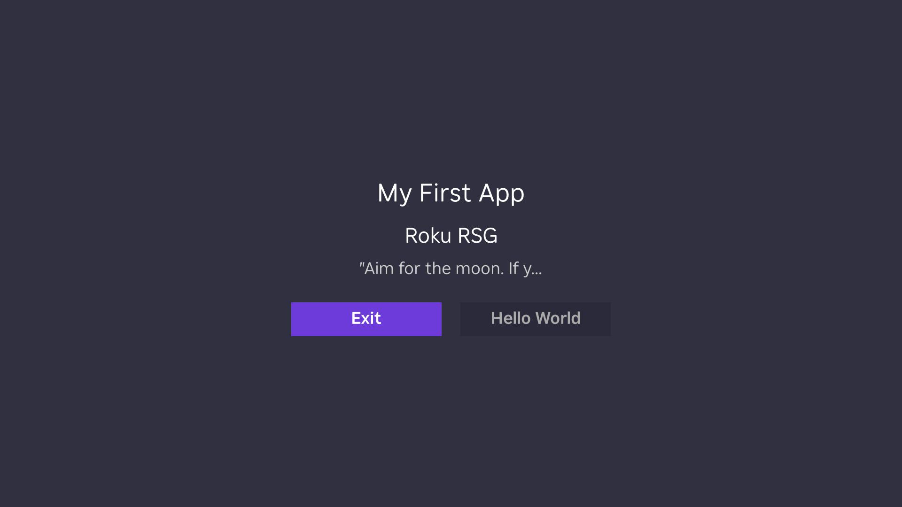
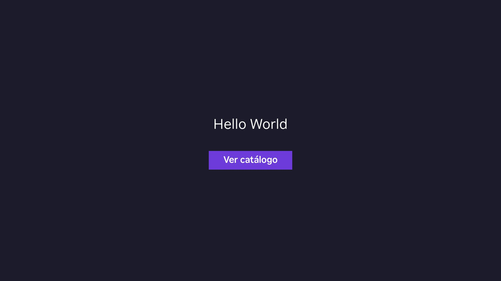
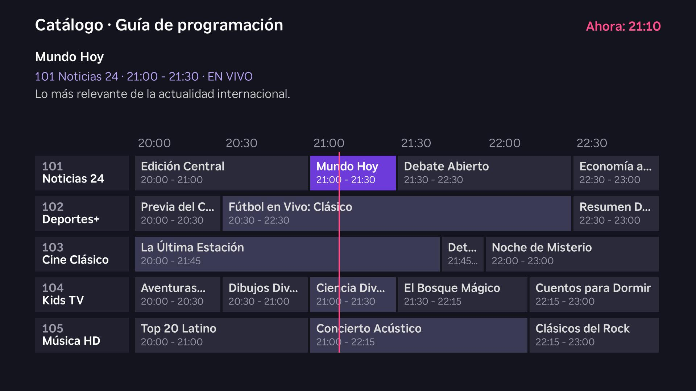

# Roku RSG 2.0 SDK Playground

A Roku app built with the RSG SDK (TypeScript + SolidJS). It started as the minimal `npx rk create` scaffold and with additional screens with remote-control navigation, a quote loaded from an API, and a simulated program guide (EPG).

## Screens

| Home | Hello World | Catalog (EPG) |
|---|---|---|
|  |  |  |

### Home
- "Title and Subtitle.
- **Random quote** loaded on launch from
  `https://prod-main-api-704464-00tre1p1erm.compute.instacloud-edge.com/api/v1/public/quotes/quote/random`,
  shown as `"quote" — author` in a centered 400 px `ScrollingLabel` that scrolls when the text doesn't fit.
  While loading it shows "Cargando cita..."; if the API fails or the response isn't valid JSON, "No se pudo cargar la cita".
- Two buttons (Left/Right to move, OK to select):
  - **Exit**: closes the app.
  - **Hello World**: opens the Hello World screen.
- **Back** on this screen also exits the app.

### Hello World
- A "Hello World" label and a **Ver catálogo** button that opens the guide.
- **Back** returns home.

### Catalog (EPG)
- Program guide with **5 made-up channels** (101 Noticias 24, 102 Deportes+, 103 Cine Clásico, 104 Kids TV, 105 Música HD) from 20:00 to 23:00, with a simulated "now" of 21:10.
- Top panel with the focused program: title, channel, time slot, "EN VIVO" when on air, and description.
- A pink line marks the current time; programs on air use a lighter shade.
- Navigation: Left/Right moves through a channel's programs; Up/Down jumps to the program airing at the same time on the neighboring channel. Focus starts on what is airing now on channel 101.
- **Back** returns to Hello World.
- It is a hand-built grid (fixed window, no scrolling). For a real catalog with more channels or hours, the native `TimeGrid` component is the right choice.

## Structure

```
src/
  index.ts                         Bootstrap: main() → registerAnchorNode(MyFirstApp)
  components/
    my-first-app.tsx               Root anchor node: focus (RootFocusBoundary) + screen stack (ScreenControllerProvider)
    home-screen.tsx                Home screen: labels, API quote and buttons
    hello-world-screen.tsx         Hello World screen with the "Ver catálogo" button
    catalog-screen.tsx             Catalog / EPG screen
    focus-button.tsx               Reusable focusable button
    my-first-app.test.tsx          Tests (Jest + @roku-sdk/testing-library)
  data/
    epg-data.ts                    Mock EPG data and the grid's navigation map
  compiled-components/
    BaseAppScene.xml / .brs        SceneGraph scene that mounts MyFirstApp
pkg/source/Main.brs                BrightScript entry point (the app's main loop)
roku-config.ts                     Build and manifest configuration
```

### How it works

- **Screen navigation:** `@roku-sdk/navigation`. Hello World and the catalog are stacked with `pushScreen` over the previous screen (each with an opaque background), and **Back** calls `popScreen`.
- **Remote-control focus:** `FocusBoundary` + `useFocusable`. Each screen takes focus when it opens, so the buttons on the screen underneath don't react. The EPG grid uses a `navigationMap` computed from the schedule.
- **Exiting the app:** the Exit button sets `MyFirstApp`'s `exitApp` output field to `true`. `BaseAppScene.brs` forwards it to `m.global.exitApp`, and `Main.brs`, which observes that field, ends the main loop so the app closes.
- **API call:** `fetch` with an `AbortController`, a `response.ok` check, and `JSON.parse(await response.text())` (not `response.json()`, which exits the app if the body isn't JSON).

## Development

Requirements: Node ≥ 24, pnpm, and a Roku with developer mode enabled (set up with the `rk` CLI).

```bash
pnpm install        # Install dependencies
npx rk dev          # Build and deploy to the Roku
pnpm test           # Run tests
pnpm run lint       # Lint sources
pnpm run type-check # Type-check
```

The tests mock the quote API (no network access) and cover loading the quote, its error cases, the Exit button, and the home → Hello World → catalog → grid navigation → Back flow.
